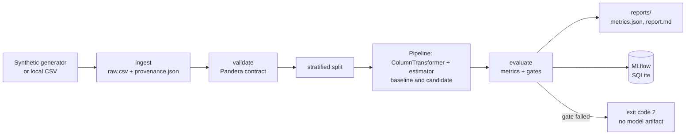

# mlops-reproducible-training

[](https://github.com/katherineJG/mlops-reproducible-training/actions/workflows/ci.yml)

A reproducible, leakage-safe customer-churn training pipeline. The focus is engineering rather than model
novelty: validated data, preprocessing fitted only on training data, tracked experiments, versioned
pipeline stages, and an evaluation gate that decides whether a candidate model is eligible.

Design notes: `docs/ARCHITECTURE.md`,
`docs/DECISIONS.md`. Model details and limitations: `MODEL_CARD.md`. Failure demos: `docs/DEMOS.md`.

## Architecture



`dvc.yaml` wires `ingest` and `train` as DVC stages; CI runs lint, types, tests and `dvc repro`.

## Quick start

Requires Python 3.12 and [uv](https://docs.astral.sh/uv/).

```bash
uv sync                  # locked dependencies into .venv
uv run dvc repro         # ingest -> validate -> train -> evaluate -> log to MLflow
make check               # ruff, ruff format, mypy (strict), pytest   (no make? see Makefile for the uv commands)
```

Individual steps:

```bash
uv run python -m churn_pipeline.ingest                       # data/raw/raw.csv + provenance.json
uv run python -m churn_pipeline.validate data/raw/raw.csv    # exit 1 + named rules on bad data
uv run python -m churn_pipeline.train                        # fit, evaluate, gate (exit 2 = candidate rejected)
```

Outputs: `data/raw/`, `models/`, `reports/` (DVC-tracked), `mlflow.db` (git-ignored).

### Docker (CPU)

```bash
docker build -t churn-pipeline:local .
docker run --rm -v "$PWD/reports:/app/reports" churn-pipeline:local
```

The container runs ingest then train. It has no `.git`, so the MLflow `git_sha` tag is `unknown` there.

### Experiment tracking (MLflow)

Each `train` run logs params, baseline and candidate metrics, git SHA (and dirty flag), dataset fingerprint,
configs, reports, provenance, a pip freeze, and, only if the candidate passes its gates, the model.

```bash
uv run python -m mlflow ui --backend-store-uri sqlite:///mlflow.db   # http://127.0.0.1:5000
```

MLflow is pinned `>=3.17,<4` and used for tracking only (no model registry).

## Configuration

`configs/data.yaml` (source, seed, rows, schema version) and `configs/model.yaml` (seed, split, threshold,
model parameters, acceptance gates). Both are validated at startup; unknown keys are rejected. DVC reads
them as pipeline params.

## Data source and license

The default dataset is **synthetic**, generated deterministically from a seed (`ingest.py`), so there is no
third-party license to comply with. A 200-row sample is committed at `data/sample/churn_sample.csv`.
The public IBM Telco churn CSV has no confirmed data license (IBM's sample repository licenses its code, not
the CSV), so it is not committed or redistributed. To try it privately, set `source: csv` and `csv_path` in
`configs/data.yaml`, with the file under `data/private/` (git-ignored). Map it to our schema first:

```bash
uv run python -m churn_pipeline.adapters data/private/ibm/Telco-Customer-Churn.csv data/private/ibm/mapped.csv
```

The adapter logs the columns it drops and the blank `TotalCharges` values it converts to missing.

## Results

One real run on synthetic data (5000 rows, 1000-row test split, threshold 0.5). Full detail in
`reports/report.md` and `MODEL_CARD.md`.

| metric | baseline | candidate |
|---|---|---|
| precision | 0.000 | 0.533 |
| recall | 0.000 | 0.751 |
| f1 | 0.000 | 0.624 |
| roc_auc | 0.500 | 0.831 |
| pr_auc | 0.277 | 0.670 |

These numbers describe the pipeline on invented data, not real-world churn performance.

## Reproducibility

A forced re-run on one machine reproduced every output hash. Across operating systems, the raw data,
fingerprint, split, report and metrics matched (Windows vs Docker, and Windows vs the Linux CI run), but the
pickled model files are not byte-identical, so compare models by metrics, not hash. Other CPUs or library
versions can change floating-point results in the last digits. MLflow run ids, timestamps and git SHA differ
per run by design. See `docs/ARCHITECTURE.md`.

## Limitations

Synthetic data, single split without confidence intervals, untuned threshold, no fairness or calibration
analysis, CPU only, no serving or monitoring (out of scope: later projects).

## Troubleshooting

| Symptom | Fix |
|---|---|
| `train` exits 2 | A gate in `configs/model.yaml` failed; the reason is in the log and `reports/report.md`. |
| `validate`/`train` exits 1 | The data broke the contract; each failed rule is listed with column and row index. |
| `mlflow` command blocked on Windows | Use `python -m mlflow ...` (Application Control can block the launcher exe). |
| `train` says `provenance.json` not found | Run the `ingest` step (or `dvc repro`) first. |
| First `pytest` run is very slow | One-off cold import of scikit-learn/MLflow; later runs take seconds. |